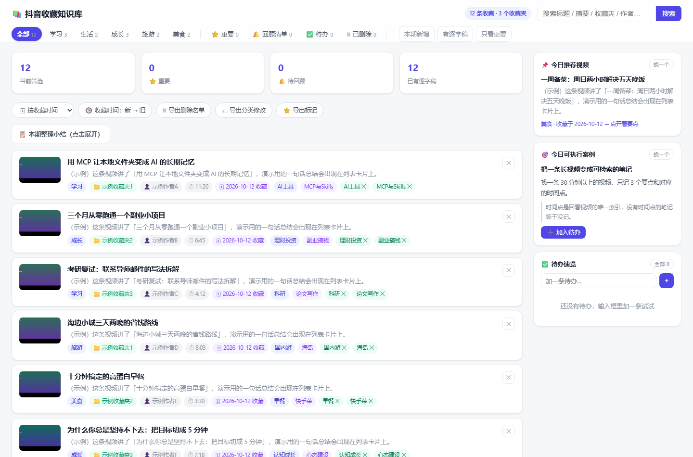
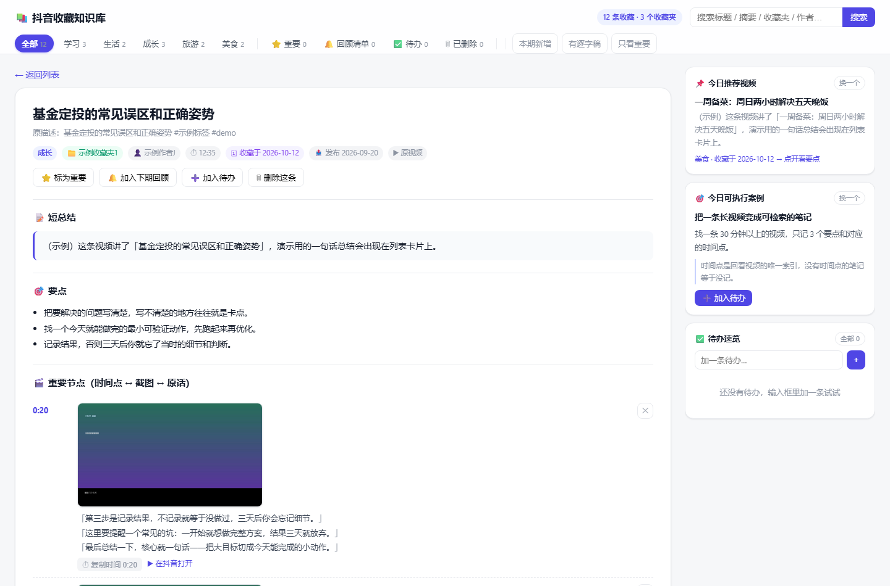

# 抖音收藏知识库 · Douyin Favorites Organizer

把**你自己账号的抖音收藏**变成一座可检索、可批注、能出周报的私人知识库。

> 抓取收藏夹（保留你的原分类）→ 下载视频 → whisper 逐字稿 + 关键帧截图 → 可批注网页 + Obsidian 笔记 + 周/季/年总结

**核心卖点**：不用整理收藏夹、不用手抄要点。跑完之后，你收藏过的每条视频都有**要点、时间轴、截图和逐字稿**，还能按「我什么时候收藏的」排序回顾。

📄 [快速开始](#三快速开始) · 想直接用 AI 复刻？跳到 [**一句话复刻**](#四一句话让-ai-帮你复刻)

---

## 效果预览

| 列表页（按收藏时间/发布时间排序 + 批注 + 待办） | 详情页（要点 · 重要节点时间轴 · 逐字稿） |
|---|---|
|  |  |

> 上图来自仓库内的**脱敏 demo 数据**（`demo/`），不是任何人的真实收藏。
> 想看真机效果：clone 之后直接双击 `demo/index.html`，不需要登录抖音、不需要装模型。

---

## 一、它解决什么问题

收藏夹的问题从来不是"收藏得不够多"，而是：

- **收藏了等于没收藏** —— 上百条躺着，从来不看第二遍；
- **想找找不回来** —— 只记得"好像看过一个讲 XX 的"；
- **长视频记不住** —— 40 分钟的播客，看完只剩模糊印象；
- **没有一个地方汇总** —— 抖音、笔记软件、待办散在三个 App 里。

这个项目把收藏变成**可检索、可回顾、可执行**的东西：每条视频有要点与时间轴，每周有小结，
每季度/每年有更高层级的聚合。

## 二、功能

- **保留你的原分类**：抓的是你真实的收藏夹结构，不是重新打乱
- **两级分类**：收藏夹 → 大类（学习/生活/成长/旅游/美食，**可自由修改**），视频级分类优先级更高
- **逐字稿**：本地 faster-whisper 转写，**不上传任何内容到云端**
- **重要节点时间轴**：场景切换检测 + 要点锚定，只截**有信息量**的画面（图表/结论/文字页），不是随机抽帧
- **可批注网页**：⭐标重要 / 🔔加入回顾 / ✕删除 / 🏷改分类 / ✅加待办，改动存本地并可导出回写
- **Obsidian 笔记**：一条视频一篇，含逐字稿、截图、专题聚合（如「AI 工具」「求职实习」）
- **周 / 季 / 年三级总结**：本期新增、主题流向、可执行案例
- **增量整理**：只处理新收藏，不重复下载和转写
- **离线可用**：`dist/` 是纯静态站点，可发布到任意静态托管

## 三、快速开始

```bash
git clone https://github.com/fluoxtine2004/douyin-favorites-organizer.git
cd douyin-favorites-organizer
pip install -r requirements.txt
python -m playwright install chromium
python run.py all          # 首次会弹出浏览器，用手机扫码登录抖音
```

跑完打开 `dashboard.html`（或 `python run.py serve` 起本地服务）。

分步跑也行：

```bash
python run.py fetch                 # 抓取收藏夹（保留原分类）
python run.py transcribe --limit 60 # 转写 + 截图（可分批，随时中断续跑）
python run.py build                 # 生成网页 / Obsidian 笔记 / 周报
```

详细步骤见 [docs/QUICKSTART.md](docs/QUICKSTART.md)，管线原理见 [docs/PIPELINE.md](docs/PIPELINE.md)。

### 环境要求

| 项 | 要求 |
|---|---|
| Python | 3.10+ |
| 系统 | Windows / macOS / Linux |
| 磁盘 | ≥ 5GB（媒体随收藏量增长） |
| 网络 | 能访问抖音；转写模型可走 ModelScope 镜像 |
| 必需 | 一部手机，用于首次扫码登录**你自己的**账号 |

## 四、一句话让 AI 帮你复刻

本项目同时是一个 **Agent Skill**，符合开放标准（[agents.md](https://agents.md) + SKILL.md）。
你不需要懂代码——把下面这句话发给你的 AI 编程助手（Claude Code / Cursor / Codex / Copilot / WorkBuddy 等）：

> 把 https://github.com/fluoxtine2004/douyin-favorites-organizer 装到本地，
> 按 AGENTS.md 跑通全流程：抓取我的抖音收藏 → 生成逐字稿和截图 → 产出网页。
> 遇到报错自己修，不要问我。完成后告诉我 dashboard 路径、总条数、待转写条数。

AI 会读 `AGENTS.md`（仓库说明书）+ `skills/douyin-favorites-organizer/SKILL.md`（工作流定义），
自己装依赖、跑管线、按验收清单自检。完整 prompt 模板与验收清单见
[docs/AI-ONE-SHOT.md](docs/AI-ONE-SHOT.md)。

支持 Agent Skills 的工具也可以直接安装：

```bash
npx skills add https://github.com/fluoxtine2004/douyin-favorites-organizer --skill douyin-favorites-organizer
```

## 五、目录结构

```
douyin-favorites-organizer/
├─ run.py                     # 统一入口：fetch / transcribe / build / serve / all
├─ AGENTS.md                  # 给 AI 助手的仓库说明书
├─ push_via_api.py            # 发布工具：只放行 api.github.com 的网络下也能推（走 REST，支持二进制）
├─ templates/dashboard.html   # 核心 UI（改界面只需要改这一个文件）
├─ config/categories.json     # 收藏夹 → 大类映射（可改）
├─ scripts/                   # 管线脚本
│  ├─ fetch_gap.py            #   抓取（保留收藏夹结构，含缺口补抓）
│  ├─ process_batch.py        #   下载 + 转写 + 抽帧
│  ├─ pick_frames.py          #   智能选帧（挑有信息量的画面）
│  ├─ enrich.py               #   清洗 + 分段 + 要点兜底
│  ├─ build_dashboard.py      #   生成可批注网页
│  ├─ generate_outputs.py     #   生成 Obsidian 笔记 + 周报 + 专题
│  ├─ build_site.py           #   打包离线站点 dist/
│  └─ legacy/                 #   一次性探针脚本（排障用）
├─ tests/                     # 渲染 / 要点规则 / 笔记完整性校验
├─ demo/                      # 脱敏示例（clone 即可看 UI）
└─ docs/                      # 快速开始 / 管线 / 排障 / AI 复刻指南
```

## 六、几个值得一看的设计决策

1. **点赞 ≠ 收藏**：抖音的 `/aweme/favorite/` 是**点赞列表**，不是收藏。
   项目里用 `collect_stat == 1` 做硬护栏，并把这条写进了文档——
   因为作者真的两次把点赞混进库里，还生成了周报。
2. **不要自己拼接口 URL**：缺签名的 raw fetch 会**静默返回空结果**（不报错！），
   看起来像"被限流"。正确姿势是驱动页面，监听页面自己发出的请求。
3. **收藏时间只能推算**：接口不返回收藏时间戳，但收藏列表按时间倒序返回，
   于是用「出现次序」+ 收藏夹内名次 + 首次入库日期合成排序键。
4. **要点必须短**：≤90 字、最多 3 条。早期版本直接把整篇逐字稿当要点，网页上成了一篇文章。
   现在三个模块共用同一套闸门，并有单元测试守着。

## 七、常见问题

见 [docs/FAQ.md](docs/FAQ.md)：登录失效、下载 403、纯音乐视频、超长视频转写慢、
收藏夹数量对不上、接口改版怎么办。

## 八、免责声明

本工具**仅用于整理使用者本人账号的收藏**，请勿用于抓取他人内容或任何商业用途。
请阅读 [DISCLAIMER.md](DISCLAIMER.md)。抓取的视频/音频/截图的著作权属于原作者，
仅限本地个人学习使用，请勿二次分发。

## 九、License

[MIT](LICENSE) © 2026 fluoxtine2004
