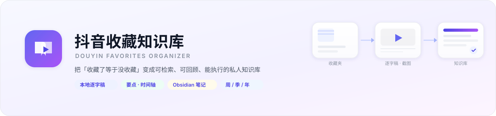
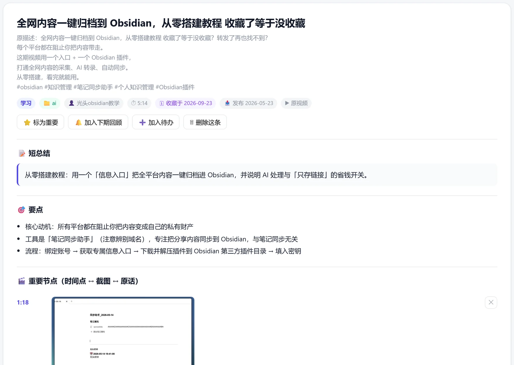
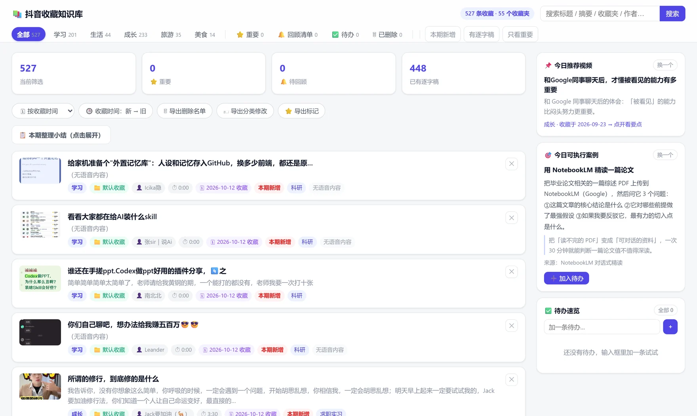
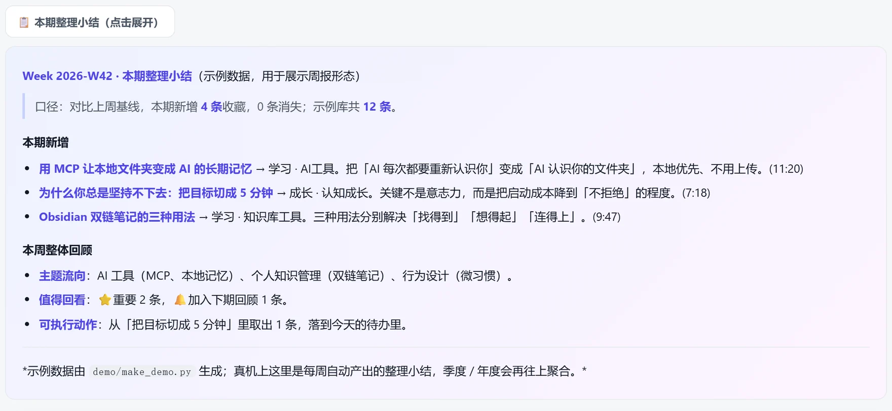
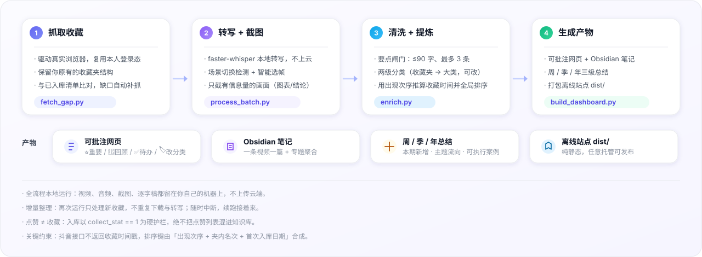

<div align="center">
  
</div>

<div align="center">

[](https://github.com/fluoxtine2004/douyin-favorites-organizer/actions/workflows/ci.yml)
[](https://github.com/fluoxtine2004/douyin-favorites-organizer/releases)
[](LICENSE)
[](https://www.python.org/)
[](AGENTS.md)
[](#环境要求)

</div>

**把抖音收藏变成一座可检索、可回顾、能出周报的私人知识库。**

跑一遍，你收藏过的每条视频都会拿到**要点、时间轴、截图和逐字稿**；
还能按「我什么时候收藏的」排序回顾，每周自动产出一份整理小结。

> 全流程本地运行：视频、音频、截图、逐字稿都留在你自己的机器上，不上传云端。

---

## 效果预览

下面这条是我库里的一条**真实收藏**（`全网内容一键归档到 Obsidian，从零搭建教程 收藏了等于没收藏`），
跑完管线之后，它在详情页里长这样：



从左到右你能看到它做了什么：

| 原始素材 | 整理后得到 |
|---|---|
| 一条 5 分 14 秒的视频 + 一段带 4 个 hashtag 的标题 | **一句话短总结** —— 这条视频到底解决了什么问题 |
| 43 秒的画面 | **3 条要点** —— 每条 ≤90 字，直接读得完 |
| 讲了三段操作 | **3 个重要节点** —— 时间点 ↔ 截图 ↔ 当时的原话，回看不用拖进度条 |
| 完整语音 | **逐字稿全文** —— 可以搜、可以复制、可以标重点 |

再往上是列表页和周报：

| 列表页：按收藏时间 / 发布时间排序，支持批注与待办 | 周报：本期新增 · 主题流向 · 可执行案例 |
|---|---|
|  |  |

> 详情与列表来自我本人的库；周报图取自仓库内**脱敏 demo 数据**（`demo/`）。
> 想直接看界面：clone 之后双击 `demo/index.html`，**不需要登录抖音、不需要装模型**。

---

## 它解决什么问题

收藏夹的问题从来不是"收得不够多"，而是：

- **收藏了等于没收藏** —— 上百条躺在那里，从来不看第二遍；
- **想找找不回来** —— 只记得"好像看过一个讲 XX 的"；
- **长视频记不住** —— 40 分钟的播客，看完只剩模糊印象；
- **散落在三个 App** —— 抖音、笔记软件、待办各存一份，没有一个地方汇总。

这个项目把收藏变成**可检索、可回顾、可执行**的东西：每条视频有要点与时间轴，每周有小结，
每季度、每年再往上一层聚合。

## 处理管线



## 快速开始

```bash
git clone https://github.com/fluoxtine2004/douyin-favorites-organizer.git
cd douyin-favorites-organizer
pip install -r requirements.txt
python -m playwright install chromium
python run.py all          # 首次会弹出浏览器，请用手机扫码登录【你自己的】抖音账号
```

跑完打开 `dashboard.html`，或 `python run.py serve` 起本地服务。

也可以分步跑，随时中断、续跑接着来：

```bash
python run.py fetch                  # 抓取收藏夹（保留你原有的分类结构）
python run.py fetch-model            # 从 ModelScope 镜像下载 whisper 模型（国内网络友好）
python run.py transcribe --limit 60  # 转写 + 抽帧，可分批
python run.py build                  # 生成网页 / Obsidian 笔记 / 周报
python run.py site                   # 打包离线站点 dist/
python run.py check                  # 跑全部自检
```

完整步骤见 [docs/QUICKSTART.md](docs/QUICKSTART.md)，管线原理见 [docs/PIPELINE.md](docs/PIPELINE.md)。

### 环境要求

| 项 | 要求 |
|---|---|
| Python | 3.10+ |
| 系统 | Windows / macOS / Linux |
| 磁盘 | ≥ 5 GB（媒体随收藏量增长） |
| 网络 | 能访问抖音；whisper 模型可走 ModelScope 镜像 |
| 必需 | 一部手机，用于首次扫码登录**你自己的**账号 |

## 核心特性

| 特性 | 说明 |
|---|---|
| **保留你的原分类** | 抓的是你真实的收藏夹结构，而不是重新打乱成一锅粥 |
| **两级分类** | 收藏夹 → 大类（学习 / 生活 / 成长 / 旅游 / 美食，**可自由修改**），视频级分类优先级更高 |
| **本地逐字稿** | faster-whisper 本地转写，**不上传任何内容到云端** |
| **重要节点时间轴** | 场景切换检测 + 要点锚定，只截**有信息量**的画面（图表 / 结论 / 文字页），不是随机抽帧 |
| **可批注网页** | ⭐标重要 · 🔔加入回顾 · ✕删除 · 🏷改分类 · ✅加待办，改动存本地并可导出回写 |
| **Obsidian 笔记** | 一条视频一篇，含逐字稿、截图、专题聚合（如「AI 工具」「求职实习」） |
| **周 / 季 / 年三级总结** | 本期新增、主题流向、可执行案例，层级式往上聚合 |
| **增量整理** | 只处理新收藏，不重复下载与转写 |
| **离线可用** | `dist/` 是纯静态站点，可发布到任意静态托管 |

## 让 AI 帮你复刻

本项目同时是一个 **Agent Skill**，符合开放标准（[AGENTS.md](https://agents.md) + `SKILL.md`）。
你不需要懂代码 —— 把下面这句话发给你常用的 AI 编程助手（Claude Code / Cursor / Codex / Copilot / WorkBuddy 等）：

> 把 https://github.com/fluoxtine2004/douyin-favorites-organizer 装到本地，
> 按 AGENTS.md 跑通全流程：抓取我的抖音收藏 → 生成逐字稿和截图 → 产出网页。
> 遇到报错自己修，不要问我。完成后告诉我 dashboard 路径、总条数、待转写条数。

AI 会读 [AGENTS.md](AGENTS.md)（仓库说明书）和
[skills/douyin-favorites-organizer/SKILL.md](skills/douyin-favorites-organizer/SKILL.md)（工作流定义），
自己装依赖、跑管线、按验收清单自检。完整 prompt 模板与验收标准见 [docs/AI-ONE-SHOT.md](docs/AI-ONE-SHOT.md)。

支持 Agent Skills 的工具也可以直接安装：

```bash
npx skills add https://github.com/fluoxtine2004/douyin-favorites-organizer --skill douyin-favorites-organizer
```

## 目录结构

```
douyin-favorites-organizer/
├─ run.py                     # 统一入口：fetch / transcribe / build / site / serve / check / all
├─ AGENTS.md                  # 给 AI 助手的仓库说明书
├─ push_via_api.py            # 发布工具：只放行 api.github.com 的网络下也能推（走 REST，支持二进制）
├─ templates/dashboard.html   # 核心 UI（改界面只需要改这一个文件）
├─ config/categories.json     # 收藏夹 → 大类映射（可改）
├─ scripts/                   # 管线脚本
│  ├─ fetch_gap.py            #   抓取（保留收藏夹结构，含缺口补抓）
│  ├─ process_batch.py        #   下载 + 转写 + 抽帧
│  ├─ pick_frames.py          #   智能选帧（挑有信息量的画面）
│  ├─ enrich.py               #   清洗 + 分段 + 要点兜底
│  ├─ build_dashboard.py      #   生成可批注网页
│  ├─ generate_outputs.py     #   生成 Obsidian 笔记 + 周报 + 专题
│  ├─ build_site.py           #   打包离线站点 dist/
│  └─ legacy/                 #   一次性探针脚本（排障用）
├─ tests/                     # 渲染 / 要点规则 / 笔记完整性校验
├─ demo/                      # 脱敏示例（clone 即可看 UI）
└─ docs/                      # 快速开始 / 管线 / 排障 / AI 复刻指南
```

## 几个值得一看的设计决策

1. **点赞 ≠ 收藏。** 抖音的 `/aweme/favorite/` 是**点赞列表**，不是收藏。项目里用 `collect_stat == 1`
   做硬护栏，并把这条写进了文档 —— 因为作者真的两次把点赞混进库里，还生成了周报。
2. **不要自己拼接口 URL。** 缺签名的 raw fetch 会**静默返回空结果**（不报错！），看起来像"被限流"。
   正确姿势是驱动页面、监听页面自己发出的请求。
3. **收藏时间只能推算。** 接口不返回收藏时间戳，但收藏列表按时间倒序返回，
   于是用「出现次序 + 收藏夹内名次 + 首次入库日期」合成排序键。
4. **要点必须短。** ≤90 字、最多 3 条。早期版本直接把整篇逐字稿当要点，网页上成了一篇文章。
   现在三个模块共用同一套闸门，并有单元测试守着。

## 常见问题

登录失效、下载 403、纯音乐视频、超长视频转写慢、收藏夹数量对不上、接口改版怎么办 ——
见 [docs/FAQ.md](docs/FAQ.md)；界面想改哪里见 [docs/SITE-CHANGE.md](docs/SITE-CHANGE.md)。

## 免责声明

本工具**仅用于整理使用者本人账号的收藏**，请勿用于抓取他人内容或任何商业用途。
请阅读 [DISCLAIMER.md](DISCLAIMER.md)。抓取到的视频、音频、截图的著作权属于**原作者**，
仅限本地个人学习使用，请勿二次分发。

## License

[MIT](LICENSE) © 2026 fluoxtine2004
